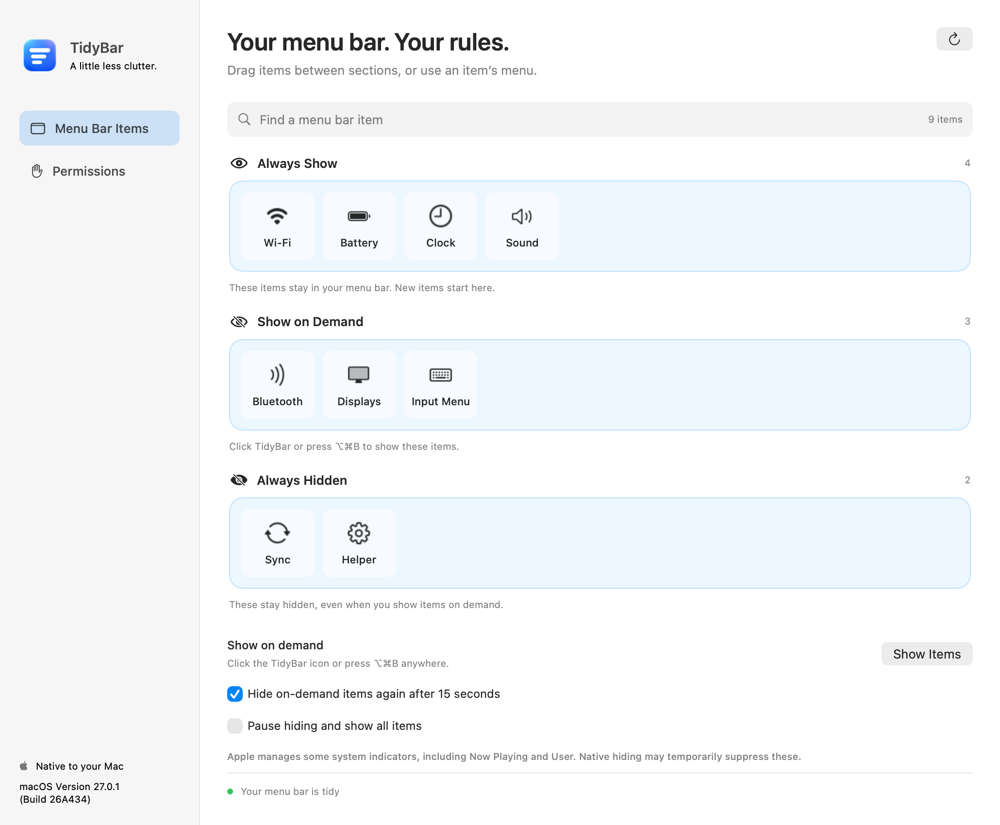
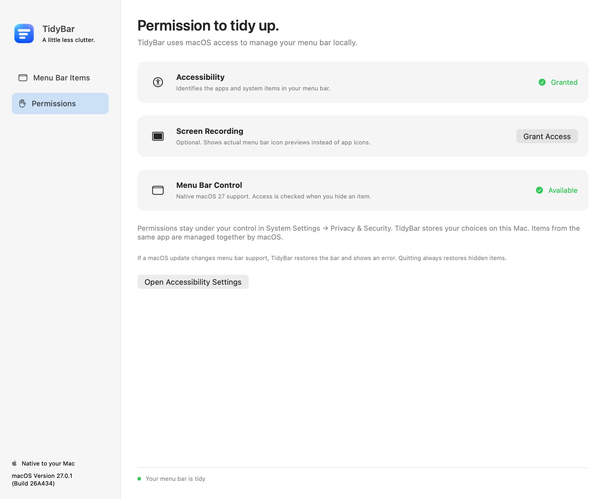

<p align="center">
  
</p>

<h1 align="center">TidyBar</h1>
<p align="center">A little less clutter.</p>
<p align="center">A native, open-source menu bar manager for macOS 27 on Apple Silicon.</p>
<p align="center">
  <a href="https://github.com/PeteTheHeat/TidyBar/releases/latest"><strong>Download for Mac</strong></a>
  · <a href="CONTRIBUTING.md">Build from source</a>
  · <a href="LICENSE">GPL-3.0</a>
</p>

<picture>
  <source media="(prefers-color-scheme: dark)" srcset="docs/images/settings-dark.png">
  
</picture>

*The actual native settings view, rendered with sample items.*

## Your menu bar. Your rules.

Choose one of three categories for each item:

| Category | What happens |
| --- | --- |
| **Always Show** | Stays visible in your menu bar. New items start here. |
| **Show on Demand** | Appears when you click TidyBar or press **⌥⌘B**. |
| **Always Hidden** | Stays hidden during a normal reveal. |

Drag items between trays, or click an item to choose its category. Changes apply immediately and are saved on your Mac. Turn on the optional 15-second auto-hide to tuck on-demand items away again.

Right-click the menu bar icon for Settings, Pause Hiding, and Quit. Closing Settings keeps TidyBar running. Pausing or quitting restores all items.

## Install

**Requirements:** an Apple Silicon Mac running macOS 27 or newer. Core behavior has been verified on **macOS 27.0.1**. Intel Macs and earlier macOS versions are not supported.

1. Download the **[DMG](https://github.com/PeteTheHeat/TidyBar/releases/download/v1.0.0/TidyBar-1.0.0-arm64.dmg)** from the [latest release](https://github.com/PeteTheHeat/TidyBar/releases/latest).
2. Open it and drag **TidyBar** to **Applications**. Open the installed copy.
3. This release is **ad-hoc signed and not notarized by Apple**. If macOS blocks it, attempt to open it, then go to **System Settings → Privacy & Security → Open Anyway** for TidyBar. Review and confirm the app. See [Apple's instructions](https://support.apple.com/en-us/102445).
4. Click **Grant Access** in TidyBar and enable it under **System Settings → Privacy & Security → Accessibility**.

A **[ZIP download](https://github.com/PeteTheHeat/TidyBar/releases/download/v1.0.0/TidyBar-1.0.0-arm64.zip)** is also available. Unzip it and move the app to Applications. Release assets include an installation guide and SHA-256 checksums. Quit TidyBar before installing an update; your categories are retained.

Run the installed copy in Applications and close other menu bar managers.

## Permissions and privacy

**Accessibility is required** to identify menu bar items. **Screen Recording is optional**, only for actual menu bar image previews. Without it, the editor uses app icons and system symbols.

Your choices stay on this Mac. Optional screen captures stay in memory. TidyBar has no account, telemetry, analytics, or network service. Permissions are requested through macOS and remain under your control in System Settings.

<details>
<summary>View the permissions screen</summary>



*Rendered with sample permission status. Your actual status appears in the app.*

</details>

## macOS limits

macOS 27 rebuilt the menu bar. TidyBar uses a guarded runtime adapter for the private **MenuBarClientCore** framework. A system update can change this API. The app reports activation failures and restores the bar when support fails. The hiding assertion belongs to the process, so macOS restores icons when the app exits, including after a crash.

- **Icons from the same app share one category.** macOS controls third-party icons by their owning application bundle.
- Nine supported system controls can be managed individually: Battery, Bluetooth, Clock, Displays, Input Menu, Sound, Wi-Fi, Screen Mirroring, and Control Center.
- Native hiding can also suppress Apple extras, including **Now Playing and Fast User Switching**. Those extras are excluded from the assignable tiles.
- TidyBar changes visibility. To change the actual order of menu bar icons, use macOS **Command-drag**.
- TidyBar is not sandboxed and is distributed outside the App Store.

## Build and verify

Use Apple's Command Line Tools or Xcode with a **macOS 27 SDK or newer**. No package dependencies or paid signing identity are needed for a local build.

```sh
git clone https://github.com/PeteTheHeat/TidyBar.git
cd TidyBar
./scripts/build.sh
./scripts/install.sh
open /Applications/TidyBar.app
```

The build produces `build/TidyBar.app`. Install it to register its application identity with macOS. An explicit `DEVELOPER_DIR` selects your toolchain.

```sh
./scripts/test-policy.sh
/Applications/TidyBar.app/Contents/MacOS/TidyBar --probe
```

An opt-in `--verify-live` harness checks real menu bar frames using three native fixture apps and restores the original categories afterward. See [CONTRIBUTING.md](CONTRIBUTING.md) for the live test and packaging commands, and [Tests/VALIDATION.md](Tests/VALIDATION.md) for the verified behavior and test limits. Policy checks also run in GitHub Actions.

## License and credits

TidyBar is free software under **[GPL-3.0](LICENSE)**. Complete corresponding source is available in this repository and its release tags.

The macOS 27 Objective-C bridge comes from **[Pelmet](https://github.com/fif7y/pelmet)** by Gabriel Faucon. See [third-party notices](THIRD_PARTY_NOTICES.md) for attribution. The app icon was made with built-in imagegen; its [generation prompt](docs/BRANDING.md) and source PNG are included.

TidyBar is an independent project, unaffiliated with Apple or Bartender.
